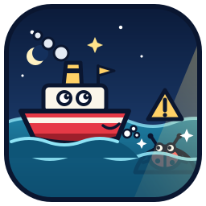

<p align="center"></p>

# Shoalscan

[](https://github.com/spark-app-studio/shoalscan/actions/workflows/test.yml)

Shoalscan runs several security scanners over a repository as one CI step. It compares their findings against a baseline and records each run, so a small dashboard can show how the codebase's security changes over time.

A shoal is a hidden hazard under the water. A lighthouse warns ships about it; Shoalscan warns a codebase about the vulnerabilities under its surface.

## Why Shoalscan

- **One scan, many pinned and verified tools.** Shoalscan runs [Opengrep](https://github.com/opengrep/opengrep) and, when you enable them, [Gitleaks](https://github.com/gitleaks/gitleaks) for secrets, [Hadolint](https://github.com/hadolint/hadolint) for Dockerfiles, [zizmor](https://github.com/zizmorcore/zizmor) for GitHub Actions and [Trivy](https://github.com/aquasecurity/trivy) for infrastructure as code, and turns their output into one finding format. Every tool and the community rules snapshot are pinned by SHA-256 in `tools.lock`, and signatures are checked where the tool publishes them.
- **Offline scans.** A scan uses local binaries and local rules only, and makes no network calls. Nothing needs a token or a secret.
- **A baseline that only shrinks.** The first full scan records every existing finding. After that, a pull request fails only on the findings it introduces, and a baseline entry that no longer reproduces also fails. On a pull request the policy is read from the base branch, so a change cannot exclude its own files or accept its own findings.
- **History and a small self-hosted dashboard.** Each run is stored in a local SQLite database, and an HTTPS dashboard shows open findings, the baseline burning down, new and fixed findings, and files that were not fully scanned. People sign in through your OpenID Connect provider, such as Dex: admins by a group or claim there, members when an admin allows them.
- **Work lists and reports.** `shoalscan triage` turns a scan into a prioritised list of what to fix, one rule family per pull request, `shoalscan triage suggest-similar` finds the findings most like one and what was decided about them with a local embedding model, and `shoalscan report` writes a dated security report from the history.

## Who it's for

- **Teams that don't host on GitHub:** GitLab, Bitbucket, Gitea or Forgejo, with CI on GitLab CI, Jenkins, Buildkite, Drone or plain cron.
- **Regulated and air-gapped organisations**, where code may not leave the network.
- **Startups working towards SOC 2 or ISO 27001**, which need evidence of security testing and a trend over time.
- **Agencies and consultancies** that look after many client repositories which cannot go to a third-party service.
- **Teams adopting static analysis on an existing codebase**, who want to block only new findings and watch the baseline shrink.
- **Teams using AI coding agents**, who want a gate for the insecure shortcuts agents take, with JSON output an agent can read.
- **Platform and DevSecOps engineers** standardising one pinned scanner and one dashboard across many repositories.

## When to use something else

- A public repository on GitHub may be better served by GitHub's free code scanning with CodeQL, which analyses data flow across files.
- For deep cross-file analysis, or a large maintained rule set with support, consider a commercial platform. Shoalscan runs open rules and does not replace code review, tests or dependency audits.

## Quickstart

Shoalscan needs Python 3.11 or later, git, and Linux or macOS. Install it from the release, then install the pinned scanners:

```sh
python3 -m pip install https://github.com/spark-app-studio/shoalscan/releases/download/v0.2.0/shoalscan-0.2.0-py3-none-any.whl
shoalscan install
```

In the root of the repository you want to scan, write a minimal `.shoalscan.toml`:

```toml
excludes = ["node_modules", "vendor"]
blocking = ["ERROR", "WARNING"]
```

Scan, record today's findings as the baseline, and check:

```sh
shoalscan scan
shoalscan baseline init --issue "#1" --reason "Existing findings at adoption, triaged in #1"
shoalscan check
```

Commit both files:

```sh
git add .shoalscan.toml .shoalscan/baseline.toml && git commit -m "Adopt Shoalscan"
```

From now on, every change is scanned and checked against that baseline:

```sh
shoalscan scan && shoalscan check
```

`check` exits with 0 when the check passes, 1 when it fails, and 2 when the setup is broken or the scan failed. It refuses findings from before the last commit or from before any edit other than to the baseline file, so scan again before you check. [Getting started](docs/getting-started.md) explains each step.

## Documentation

1. [Getting started](docs/getting-started.md): install Shoalscan and the pinned scanners, run the first scan and write the first baseline.
2. [Configuration](docs/configuration.md): every `.shoalscan.toml` key, and partial parses with `parse_warn_only`.
3. [The baseline and the check](docs/baseline-and-check.md): findings and fingerprints, the baseline file, `check` and its summary, inline suppressions, renames, and why pull requests read the policy from the base branch.
4. [CI](docs/ci.md): the GitHub Actions workflow, the self-hosted runner script and the recommended CODEOWNERS.
5. [Scanners](docs/scanners.md): Opengrep, Gitleaks, Hadolint, zizmor and Trivy, and how the scanned repository is kept from silencing them.
6. [Rules](docs/rules.md): Shoalscan's own rules and the community rules snapshot.
7. [The dashboard](docs/dashboard.md): recording runs, correcting the history, serving the dashboard and its pages.
8. [Reviewing findings](docs/reviewing-findings.md): review statuses, automatic verification of fixes, and `triage export`.
9. [The triage work list](docs/triage.md): `shoalscan triage`, a prioritised work list of the last scan's findings, grouped by rule family and component.
10. [The security report](docs/report.md): `shoalscan report`, a dated report on a repository's security over a period, from the run history.
11. [Scheduled scans](docs/scheduled-scans.md): nightly scans of the default branch with the example script and units.
12. [Scanning from the dashboard](docs/dashboard-scanning.md): registered repositories, Rescan, and the Configuration page.
13. [Security model](docs/security-model.md): how the dashboard and the scan worker protect themselves.
14. [Limits](docs/limits.md): what static analysis and Shoalscan's own safeguards cannot do.
15. [Development](docs/development.md): running the tests, the code style and fuzzing.
16. [Command and file reference](docs/reference.md): every command, the exit codes, and the files Shoalscan reads and writes.

**Design and contributing:** [docs/design.md](docs/design.md) describes the goals, principles and plan.

## Status

Early development. Phase 1 (Opengrep install, scan, baseline and check) and phase 2 (the run history and the dashboard) are done. Phase 3 added triage work lists (`shoalscan triage`) and dated security reports (`shoalscan report`). Phase 4 added Gitleaks for secrets, Hadolint for Dockerfiles, zizmor for GitHub Actions and Trivy for infrastructure as code. Clippy's security lints are left out: they compile the scanned crate, which runs its code. See [CHANGELOG.md](CHANGELOG.md) for changes.

## Contributing and security

Contributions are welcome: [CONTRIBUTING.md](CONTRIBUTING.md) explains how to set up, test and sign off a change, and everyone taking part follows the [Code of Conduct](CODE_OF_CONDUCT.md). Please report security vulnerabilities privately as described in [SECURITY.md](SECURITY.md), never in a public issue.

## Licence

Shoalscan is licensed under the [Apache License 2.0](LICENSE). The Opengrep community rules that `shoalscan install` can download are not part of Shoalscan; they keep their own licence (see [Rules](docs/rules.md#the-community-rules-snapshot)).
